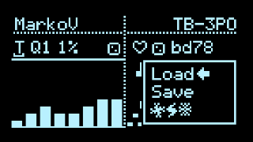
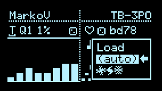

# Presets

## Floating Config Menu: Presets

The first few options in the [config menu](Hemisphere-Config) are **Load**, **Save**, **(auto)**, and a **randomize** action.

Rotate either encoder to select, push to enter. Press one of the select buttons to cancel. Applets with their state are recalled, along with Clock settings, General Settings and Input Mappings.

The **randomize** action (indicated with strange symbols) resets Input Mappings and Clock settings to defaults, and picks applets at random for inspiration.

Saved presets show the applet names; the current slot has a Zap icon.

In this menu screen:
* rotate LEFT Encoder to toggle between Load, Save, and DELETE.
* Rotate/Push RIGHT Encoder to make a selection (rotate and push).

Teensy 4.0 provides 50 preset slots.

***

### Load Presets via MIDI PC

Sending MIDI Program Change messages will load the corresponding preset:
* Value 0: Preset A
* Value 1: Preset B
* Value 2: Preset C
* Value 3: Preset D

Continue up to 50 preset slots on Teensy 4.0.

The MIDI Channel used to receive PC messages can be configured on the next page, [General Settings](Hemisphere-General-Settings).

***

### Auto-save

If enabled, settings are automatically stored in the last loaded Preset when the screensaver is invoked, or when visiting the Main Menu via Right Encoder Long-press. (You can set the screensaver timeout as low as 1 minute in Calibration)

Presets are written immediately to `VHEM40_PRESETS.DAT` in internal LittleFS storage. Save global settings separately when changing scales or waveforms.
